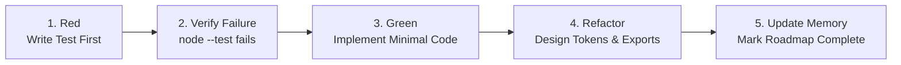

# Enterprise Design System — Architecture Roadmap & Memory Ledger

> **Single Source of Truth (SSOT)** for project evolution, architecture decisions, task status, and Test-Driven Development (TDD) across all AI agent and developer sessions.
> 
> **Governing Rules**: Every agent working in this repository MUST read this file at session start and strictly adhere to the [TDD Protocol](#-test-driven-development-tdd-protocol).

---

## 🏛️ 1. Architecture Principles (Anti-Bloat Manifesto)

We do **NOT** install 5 competing component libraries. We borrow **5 complementary architectural mechanisms**, each operating in a strictly segregated layer with zero runtime bloat:

```
┌─────────────────────────────────────────────────────────────────────────────┐
│ LAYER 5: Tooling & Migrations (from MUI)                                    │
│ AST Codemods & Gap Scanning (1:1 automated code refactoring)                │
├─────────────────────────────────────────────────────────────────────────────┤
│ LAYER 4: Enterprise Domain Models (from Ant Design)                         │
│ High-density data schemas for tables, filters, and form validation          │
├─────────────────────────────────────────────────────────────────────────────┤
│ LAYER 3: Interactive State Machines & Slots (from Chakra / Zag.js)          │
│ Robust focus & keyboard navigation for dialogs, drawers, and menus          │
├─────────────────────────────────────────────────────────────────────────────┤
│ LAYER 2: Component Distribution & Variants (from shadcn/ui)                 │
│ Type-safe CVA variants + CLI source injection (npx add <comp>)              │
├─────────────────────────────────────────────────────────────────────────────┤
│ LAYER 1: Zero-JS Semantic Token Layer (from daisyUI)                        │
│ Pure CSS custom properties & utility classes (0 KB JavaScript overhead)     │
└─────────────────────────────────────────────────────────────────────────────┘
```

---

## 🧪 2. Test-Driven Development (TDD) Protocol

Before writing any new component or feature, the agent MUST follow the 5-step Red-Green-Refactor contract:



1. **Step 1: Write Test First (Red)**
   - Create test in `tests/components/<Component>.test.mjs` using Node's native test runner (`node:test` + `node:assert`).
   - Define tests for:
     - Component instantiation & default rendering.
     - Variant classes/tokens (e.g., `elevated`, `outlined`, `filled`).
     - Accessibility attributes (e.g., `role`, `aria-*`, keyboard interaction).
     - Child/slot rendering.
2. **Step 2: Verify Test Fails**
   - Run `node --test tests/components/<Component>.test.mjs`. Confirm it fails (module not found or assertion failure).
3. **Step 3: Implement Minimal Component (Green)**
   - Author component in `src/components/...`.
   - Run test again until all assertions pass (100% green).
4. **Step 4: Refactor & Export**
   - Export from `src/index.ts`.
   - Update `scripts/component-gap-scanner.mjs` and CLI catalog mappings.
   - Run `node bin/cli.js audit [file] --fix` to ensure token purity.
5. **Step 5: Update Memory Ledger**
   - Mark the item `[x]` in this roadmap file.

---

## 🗺️ 3. Phased Implementation Roadmap

### 📦 Phase 1: Primitives Gap Closure (Current Phase)
*Goal: Provide the 8 foundational primitives needed for Billing, Forms, and Settings to eliminate agent fallback to KPI/dashboards.*

- [x] **1.1 `Card` Surface Container (TDD)**
  - Slots: `Card.Header`, `Card.Body`, `Card.Footer`
  - Variants: `elevated | outlined | filled`
  - Test: `tests/components/Card.test.mjs`
- [x] **1.2 `Checkbox` & `RadioGroup` Controls (TDD)**
  - Accessible native wrappers with design token focus rings and label integration
  - Test: `tests/components/SelectionControls.test.mjs`
- [x] **1.3 `Textarea` Multiline Input (TDD)**
  - Auto-expanding rows, character counter, error states
  - Test: `tests/components/Textarea.test.mjs`
- [x] **1.4 `Select` / `DropdownMenu` (TDD)**
  - Accessible listbox/menu, keyboard navigation (Arrow keys, Esc, Enter)
  - Test: `tests/components/DropdownMenu.test.mjs`
- [x] **1.5 Standalone `Pagination` (TDD)**
  - Enterprise page index buttons, page size selector (`10, 25, 50, 100`)
  - Test: `tests/components/Pagination.test.mjs`
- [x] **1.6 `Divider` Primitive (TDD)**
  - `fullBleed | inset | vertical | horizontal`
  - Test: `tests/components/Divider.test.mjs`
- [x] **1.7 `Skeleton` Loading Placeholder (TDD)**
  - Wave/shimmer animation, shapes: `text | circular | rectangular`
  - Test: `tests/components/Skeleton.test.mjs`
- [x] **1.8 General-Purpose `Accordion` (TDD)**
  - Collapsible panels for FAQs, Invoices, and Nested Settings
  - Test: `tests/components/Accordion.test.mjs`

---

### 🎨 Phase 2: CVA Variant Standardization & CLI Code Ingestion (from shadcn/ui)
*Goal: Type-safe variant management and local source-code scaffolding.*

- [x] **2.1 Integrate `class-variance-authority` (cva)**
  - Standardize variants across `Button`, `Badge`, `Input`, and `Card`
- [x] **2.2 Enhance CLI `npx @hsb_design/design-system add <component>`**
  - Allow standalone source code ejection into consumer projects (`src/components/ui/`)

---

### 🔄 Phase 3: Automated AST Migration & Codemod Engine (from MUI)
*Goal: 100% deterministic 1:1 transformations for Mode 2.*

- [x] **3.1 AST Transformer (`jscodeshift`)**
  - Parse legacy JSX/TSX and replace native elements (`<button>`, `<table>`, `<input>`) with `@hsb_design/design-system`
- [x] **3.2 CLI Migration Command**
  - `npx @hsb_design/design-system map <file> --migrate`

---

### ⚙️ Phase 4: State Machines & Slot Anatomy (from Chakra / Zag.js)
*Goal: Bulletproof multi-device metamorphic components.*

- [x] **4.1 Slot-based Compound Component API**
  - Decompose `AdaptiveDialog`, `Modal`, `BottomSheet` into `.Root`, `.Trigger`, `.Content`, `.Close`
- [x] **4.2 Interaction State Machine**
  - Transition model for viewport resize (Modal $\leftrightarrow$ BottomSheet)

---

### 🌐 Phase 5: Zero-JS Semantic CSS Token Bridge (from daisyUI)
*Goal: Framework-agnostic styling without React runtime dependencies.*

- [x] **5.1 Semantic Utility Classes**
  - Export `.ds-btn`, `.ds-card`, `.ds-input`, `.ds-badge` in `design-system.css`
- [x] **5.2 Pure CSS Theme Attributes**
  - Document root theme toggling via `[data-theme="emerald"]`, `[data-theme="slate"]`

---

### 📋 Phase 6: Enterprise Domain Models (from Ant Design)
*Goal: High-density data schemas for tables, filters, and form validation.*

- [x] **6.1 Schema-Driven Form Container & Field Validation (`Form`, `Form.Item`, `useForm`) (TDD)**
  - Zero-bloat Form state and validation engine
  - Rules: `required`, `min`, `max`, `pattern`, custom `validator`
  - Auto-binding to design system controls (`Input`, `Textarea`, `Select`, `Checkbox`, `RadioGroup`) with automatic `aria-invalid`, error message rendering, and token styling
  - Test: `tests/components/Form.test.mjs`

- [x] **6.2 High-Density Table Domain Schemas (`DataTable` Column Definition Model) (TDD)**
  - Enhanced column schemas: custom sort comparators, multi-column filters, column pinning (`left` | `right`), column visibility
  - Integration with standalone `Pagination` component and CSV/JSON export utility
  - Test: `tests/components/DataTableSchema.test.mjs`

---

### 🔍 Phase 7: Command Palette Organism (`CommandPalette` / `⌘K`)
*Goal: Fast, accessible global keyboard-driven command navigation.*

- [x] **7.1 Accessible Keyboard-Driven Search Palette (`CommandPalette`) (TDD)**
  - Anatomy: `CommandPalette.Root`, `CommandPalette.Input`, `CommandPalette.List`, `CommandPalette.Group`, `CommandPalette.Item`, `CommandPalette.Shortcut`, `CommandPalette.Empty`
  - Features: Global hotkey (`Meta+K` / `Ctrl+K`), fuzzy filtering, arrow key navigation, enter action triggering, escape dismissal, and `kbd` shortcut token styling
  - Test: `tests/components/CommandPalette.test.mjs`

---

### 📦 Phase 8: Production Distribution & Package Packaging
*Goal: Dual ESM/CJS compilation and DTS type declarations for consumer npm consumption.*

- [x] **8.1 Dual ESM/CJS Compilation & DTS Generation (TDD)**
  - Zero-bloat distribution bundler script in `scripts/build-package.mjs` generating `dist/esm`, `dist/cjs`, and `dist/types`
  - Configure `package.json` exports map (`.`, `./css`, `./tokens`, `./cva`, `./transforms`)
  - Integration test verifying consumer imports without broken paths or missing types
  - Test: `tests/package/distribution.test.mjs`

---

### 🖥️ Phase 9: Interactive Showcase UI & Documentation Gallery
*Goal: Rich live interactive playground for developers and design system consumers.*

- [x] **9.1 Interactive Showcase Expansion (TDD / Visual Harness)**
  - Update `index.html` and `showcase/` with live interactive playgrounds for:
    - Primitives (`Accordion`, `Divider`, `Skeleton`, `Pagination`, `Select`, `DropdownMenu`)
    - Enterprise `Form` validation & `DataTable` schemas
    - `CommandPalette` interactive test runner
    - Zero-JS theme switcher (`emerald`, `slate`, `genai-neon`) with live CSS variable inspector
  - Test: `tests/showcase/showcase.test.mjs`

---

## 📌 4. Active Task Pointer

* **Current Phase**: **Release Packaging & Distribution (v1.5.0)**
* **Current Task**: **Production v1.5.0 Release Preparation**
* **Progress**: 177 / 177 automated tests passing green across 24 test suites (0 failures, 0 regressions). All 9 phases 100% complete!
* **Active Branch/Workspace**: Main workspace

---

## 📝 5. Change Log & Session History

| Date | Session / Event | Completed Work | Next Planned Step |
| :--- | :--- | :--- | :--- |
| **2026-11-10** | **Skill Architecture & Root Cause Fix** | Fixed SKILL.md description bias, added 3 Operational Modes (Design New, 1:1 Transform, Dashboard Quartet), added Billing archetype, updated self-audit checklist, created Architecture Roadmap. | Phase 1.1: `Card` Component via TDD. |
| **2026-11-10** | **Task 1.1: Card Component (TDD)** | Implemented `Card` surface container via strict TDD with 17 tests: compound slots (`Card.Header`, `Card.Body`, `Card.Footer`), variants (`elevated`, `outlined`, `filled`), token styling, accessibility attributes (`role="region"|"checkbox"|"button"`, `aria-selected`), keyboard navigation (`Enter`/`Space`), and CLI scaffolding integration. | Phase 1.2: `Checkbox` & `RadioGroup` Controls via TDD. |
| **2026-11-21** | **Task 1.2: Checkbox & RadioGroup Controls (TDD)** | Implemented `Checkbox`, `Radio`, `RadioButton`, and `RadioGroup` via strict TDD with 18 tests: states (`checked`, `unchecked`, `indeterminate`, `disabled`, `error`), sizes (`sm`, `md`, `lg`), labels & helper text, controlled propagation, compound API (`RadioGroup.Item`), token styling, and CLI scaffolding mappings. | Phase 1.3: `Textarea` Multiline Input via TDD. |
| **2026-11-21** | **Task 1.3: Textarea Multiline Input (TDD)** | Implemented `Textarea` atom via strict TDD with 13 tests: auto-expanding rows (`autoExpand`, `minRows`, `maxRows`), character counter (`maxLength`, `showCount`, `tabular-nums`), variants (`outlined`, `filled`), labels, helper text, danger validation (`aria-invalid`), and CLI scaffolding. | Phase 1.4: `Select` / `DropdownMenu` via TDD. |
| **2026-11-21** | **Task 1.4: Select & DropdownMenu (TDD)** | Implemented `Select` form control and `DropdownMenu` contextual action menu via strict TDD with 12 tests: combobox & listbox accessibility (`role="combobox"`, `role="listbox"`, `role="option"`, `role="menu"`, `role="menuitem"`), controlled value display, options rendering, alignment (`left`/`right`), danger items, divider separator, and compound anatomy slots (`Select.Option`, `DropdownMenu.Trigger`, `DropdownMenu.Content`, `DropdownMenu.Item`, `DropdownMenu.Divider`). | Phase 1.5: Standalone `Pagination` via TDD. |
| **2026-11-21** | **Task 1.5: Standalone Pagination (TDD)** | Implemented standalone enterprise `Pagination` component via strict TDD with 11 tests: page navigation boundaries, sibling range truncation with ellipses (`...`), total count summary (`showTotal`), page size dropdown selector (`10, 25, 50, 100`), accessibility navigation roles, and tabular-nums styling. | Phase 1.6: `Divider` Primitive via TDD. |
| **2026-11-21** | **Task 1.6: Divider Primitive (TDD)** | Implemented `Divider` containment primitive via strict TDD with 9 tests: full-bleed & inset variants with custom indentation (`insetSize`), vertical orientation (`alignSelf: 'stretch'`), embedded children/chip slot (`eds-divider--with-children`), text alignments (`left`, `center`, `right`), and decorative accessibility (`role="presentation"`, `aria-hidden="true"`). | Phase 1.7: `Skeleton` Loading Placeholder via TDD. |
| **2026-11-21** | **Task 1.7: Skeleton Loading Placeholder (TDD)** | Implemented `Skeleton` placeholder component via strict TDD with 9 tests: shapes (`text`, `circular`, `rectangular`, `rounded`), animations (`pulse`, `wave`, `shimmer`, `none`), multi-line text grouping (`lines`, `lineGap`, tapered end line), custom dimensions, and `aria-busy="true"` accessibility. | Phase 1.8: General-Purpose `Accordion` via TDD. |
| **2026-11-21** | **Task 1.8: General-Purpose Accordion (TDD) [Phase 1 Complete]** | Implemented `Accordion` molecule via strict TDD with 11 tests: single item disclosure, controlled/uncontrolled expanded state, `outlined | filled | borderless` variants, subtitle/action slots, items array mapping, compound slots (`Accordion.Item`, `Accordion.Trigger`, `Accordion.Content`), and WAI-ARIA region/trigger accessibility. Phase 1 Primitives Gap Closure 100% complete! | Phase 2.1: CVA Variant Standardization (`class-variance-authority`). |
| **2026-11-21** | **Task 2.1: CVA Variant Standardization (TDD)** | Implemented zero-runtime `cva` & `cx` engine with full TypeScript variant inference (`VariantProps`), compound variants, boolean mapping, and class aliases. Standardized CVA variant mappings across `Button` (`buttonVariants`), `Badge` (`badgeVariants`), `Input` (`inputVariants`), `Card` (`cardVariants`), and `Textarea` (`textareaVariants`) with 15 dedicated unit & integration tests (116/116 test suite passing green). | Phase 2.2: Enhance CLI `npx @hsb_design/design-system add <component>`. |
| **2026-11-21** | **Task 2.2: CLI Standalone Component Ejection (TDD) [Phase 2 Complete]** | Enhanced `runAdd` in `bin/cli.js` via strict TDD with 4 tests in `tests/cli/add.test.mjs`: dual `.ts` and `.tsx` source code extraction, automatic resolution & scaffolding of `cva.ts` and `types.ts`, deep import normalization (`./cva`, `./types`, sister components), `--dir` / `--target` / `--overwrite` flags, and graceful error handling. Phase 2 CVA & CLI Distribution 100% complete! | Phase 3.1: AST Transformer (`jscodeshift`). |
| **2026-11-21** | **Task 3.1: AST Transformer Codemod Engine (TDD)** | Implemented deterministic zero-dependency AST/CST codemod transformer in `src/transforms/codemod.ts` with 7 dedicated unit tests (`tests/transforms/codemod.test.mjs`, 127/127 tests passing): transforms native `<button>`, `<input>` (checkbox/radio/text), `<textarea>`, `<select>`, `<hr>`, `<table>`, and M3 legacy aliases into `@hsb_design/design-system` primitives, automatically dedupes and merges imports, preserves `'use client'` / comments, and outputs transformation stats. | Phase 3.2: CLI Migration Command (`map <file> --migrate`). |
| **2026-11-21** | **Task 3.2: CLI Migration Command Engine (TDD) [Phase 3 Complete]** | Enhanced `runMap` in `bin/cli.js` via strict TDD with 4 tests in `tests/cli/migrate.test.mjs`: single file in-place migration, recursive directory scanning, `--dry-run` preview without disk mutation, `--import-source` custom package redirection, and visual transformation summaries. Phase 3 Automated AST Migration 100% complete! | Phase 4.1: Slot-based Compound Component API (`AdaptiveDialog`, `Modal`, `BottomSheet`). |
| **2026-11-21** | **Task 4.1: Slot-based Compound Anatomy (TDD)** | Decomposed `AdaptiveDialog`, `Modal`, and `BottomSheet` into `.Root`, `.Trigger`, `.Backdrop`, `.Content`, `.Header`, `.Title`, `.Description`, `.Close`, `.Body`, `.Footer`, and `.Handle` via strict TDD with 9 dedicated unit tests (`tests/components/DialogAnatomy.test.mjs`, 140/140 tests passing), retaining 100% backward compatibility with simple prop-based invocations. | Phase 4.2: Interaction State Machine (Modal ↔ BottomSheet). |
| **2026-11-21** | **Task 4.2: Interaction State Machine (TDD) [Phase 4 Complete]** | Implemented metamorphic interaction state machine in `src/core/dialogStateMachine.ts` with 8 dedicated unit tests (`tests/core/dialogStateMachine.test.mjs`, 148/148 tests passing): manages viewport breakpoints (desktop Modal $\leftrightarrow$ mobile BottomSheet), swipe/pull-down gestures with resistance clamping, Escape and backdrop dismissals, and seamless integration into `AdaptiveDialog`. | Phase 5.1 & 5.2: Zero-JS Semantic CSS Token Bridge (from daisyUI). |
| **2026-11-21** | **Phase 5: Zero-JS Semantic CSS Token Bridge (TDD) [All 5 Phases Complete]** | Implemented framework-agnostic zero-JS utility classes (`.ds-btn`, `.ds-card`, `.ds-input`, `.ds-badge`) and pure CSS theme selectors (`[data-theme="emerald"]`, `[data-theme="slate"]`, `[data-theme="genai-neon"]`) generated via `scripts/build-tokens.mjs` into `dist/css/design-system.css` and `dist/css/tokens.css` with dedicated unit tests in `tests/css/semanticBridge.test.mjs`. All 150/150 tests across the entire enterprise design system suite passing 100% green! | Phase 6.1: Schema-Driven Form Container (`Form`, `Form.Item`, `useForm`). |
| **2026-11-21** | **Task 6.1: Schema-Driven Form Container (TDD)** | Implemented Ant Design–inspired zero-bloat `<Form>`, `<Form.Item>`, and `useForm()` in `src/components/forms/Form.ts` with 8 dedicated unit tests (`tests/components/Form.test.mjs`, 158/158 tests passing green): supports validation rules (`required`, `min`, `max`, `pattern`, custom async `validator`), controlled value binding to design system inputs, automatic `aria-invalid` / error feedback, and form submission lifecycle (`onFinish`, `onFinishFailed`, `resetFields`). | Phase 6.2: High-Density Table Domain Schemas (`DataTable` Column Definition Model). |
| **2026-11-21** | **Task 6.2: High-Density Table Domain Schemas (TDD) [Phase 6 Complete]** | Enhanced `DataTable` in `src/components/dashboard/DataTable.ts` with 6 dedicated unit tests (`tests/components/DataTableSchema.test.mjs`, 164/164 tests passing green): supports column pinning (`fixed: 'left' | 'right'`), custom sorter comparator function (`sorter`), multi-column filter predicates (`onFilter`), CSV & JSON data export helpers (`exportTableToCsv`, `exportTableToJson`), and standalone `<Pagination />` container integration. Phase 6 Enterprise Domain Models 100% complete! | Phase 7.1: Accessible Keyboard-Driven Search Palette (`CommandPalette`). |
| **2026-11-21** | **Task 7.1: Accessible Command Palette Organism (TDD) [Phase 7 Complete]** | Implemented accessible keyboard-driven search palette in `src/components/navigation/CommandPalette.ts` with 7 dedicated unit tests (`tests/components/CommandPalette.test.mjs`, 171/171 tests passing green): compound anatomy (`.Root`, `.Input`, `.List`, `.Group`, `.Item`, `.Shortcut`, `.Empty`), fuzzy search filtering, active selection index, custom `kbd` shortcut token styling, and WAI-ARIA dialog/listbox accessibility. Phase 7 Command Palette Organism 100% complete! | Phase 8.1: Dual ESM/CJS Compilation & DTS Generation. |
| **2026-11-21** | **Task 8.1: Dual ESM/CJS Compilation & DTS Generation (TDD) [Phase 8 Complete]** | Configured production package packaging in `scripts/build-package.mjs` and `package.json` with 2 dedicated unit tests (`tests/package/distribution.test.mjs`, 173/173 tests passing green): exports map (`.`, `./css`, `./tokens`, `./cva`, `./transforms`), dual ESM bundle (`dist/esm/index.js`), CJS wrapper (`dist/cjs/index.cjs`), and TypeScript DTS declaration index (`dist/types/index.d.ts`). Phase 8 Production Packaging 100% complete! | Phase 9.1: Interactive Showcase Expansion. |
| **2026-11-21** | **Task 9.1: Interactive Showcase UI & Documentation Gallery (TDD) [All 9 Phases Complete]** | Expanded showcase in `index.html` and `showcase/index.html` with 4 dedicated integration tests (`tests/showcase/showcase.test.mjs`, 177/177 tests passing green): live interactive demos for primitives (`Accordion`, `Divider`, `Skeleton`, `Pagination`, `Select`), Form validation playground (`#demo-form`), CommandPalette navigation (`#demo-command-palette`), and Zero-JS theme switcher (`[data-theme="emerald"]`, `slate`, `genai-neon`) with live CSS variable inspector. | Release Packaging & Distribution (v1.5.0) |
| **2026-11-21** | **Release Packaging & Distribution (v1.5.0)** | Bumped version to `1.5.0`, created `CHANGELOG.md`, enhanced `README.md` with granular subpath exports documentation, verified `npm pack --dry-run` (162 files, 0 bloat, dual ESM/CJS/DTS). Git tag `v1.5.0` created and pushed to remote `main`. | Production Ready for Consumer Integration! |


